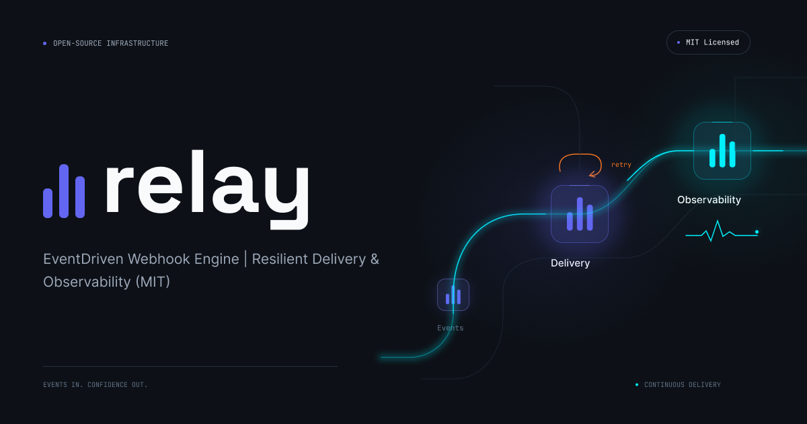

# Relay

**Webhook reliability platform for resilient event delivery.**

Relay accepts signed webhook events, persists them safely, delivers them asynchronously, retries transient failures with exponential backoff, and prevents duplicate business effects through idempotency.

[](https://github.com/Dieu-Merci-Ndenga/relay/actions/workflows/ci.yml)
[](LICENSE)

<p align="center">
  <a href="https://relay-landing-d0u6.onrender.com">
    
  </a>
</p>

## Live Deployment

The demo runs on Render's free tier, so the first request after a period of inactivity can take a while.

- **API:** [https://relay-api-brv0.onrender.com](https://relay-api-brv0.onrender.com)
- **Health check:** [https://relay-api-brv0.onrender.com/health](https://relay-api-brv0.onrender.com/health)
- **Console:** [https://relay-dashboard-nrqs.onrender.com](https://relay-dashboard-nrqs.onrender.com/)

## Quick Start

```bash
npm ci
docker compose up -d     # PostgreSQL and Redis
npm run start:dev        # API on http://localhost:3000
```

Then send a signed event (see [Example Request](#example-request)) or run the [reliability demonstration](#reliability-demonstration).

## Why Relay Exists

Webhook providers can deliver the same event more than once, while downstream systems may be temporarily unavailable. A reliable consumer must acknowledge events safely, avoid blocking the incoming request on downstream availability, retry transient failures, preserve an auditable history, and provide an operational recovery path.

Relay is designed around **at-least-once delivery** and explicit idempotency. Exactly-once delivery cannot be guaranteed across a database, a queue, and an external HTTP service, so Relay makes repeated delivery safe instead.

## Core Capabilities

- HMAC-SHA256 signature validation using the raw request body.
- Persistent event storage in PostgreSQL.
- Idempotent event ingestion with a unique event ID per source.
- Transactional outbox with a sweeper that recovers events lost before queueing.
- Signed outbound deliveries (HMAC-SHA256) with timeout and no redirects.
- Asynchronous delivery through Redis and BullMQ, with a dedicated retry queue.
- Prometheus metrics on `/metrics`.
- Exponential backoff with configurable jitter and up to five delivery attempts.
- Optional per-source event TTL with expired events routed to the DLQ.
- Delivery history including status, HTTP status, error cause, duration, and timestamp.
- Dead-letter queue after the retry policy is exhausted.
- Manual retry for retryable dead-lettered events.
- Graceful recovery when the downstream receiver becomes available again.
- Automated unit, end-to-end, and real-world failure/recovery demonstrations.

## Architecture

```text
Webhook provider
	|
	|  signed HTTP request
	v
NestJS API ------> PostgreSQL
	|
	|  idempotent enqueue
	v
Redis / BullMQ ------> Delivery worker ------> Downstream receiver
	|                      |
	| retries              | attempts, errors, durations
	v                      v
  delayed jobs          PostgreSQL history / DLQ
```

### Project Stack

| Technology | Role                                                        |
| ---------- | ----------------------------------------------------------- |
| TypeScript | Type-safe application and domain code                       |
| NestJS     | HTTP API, dependency injection, and application modules     |
| PostgreSQL | Durable event, attempt, and dead-letter storage             |
| Redis      | Fast queue backend and distributed job coordination         |
| BullMQ     | Asynchronous delivery, retries, and exponential backoff     |
| Docker     | Reproducible local infrastructure with PostgreSQL and Redis |

The project is deployed through a Render Blueprint defined in [render.yaml](render.yaml).

## API

### Receive an event

```text
POST /webhooks/:source
```

Required headers:

```text
x-relay-event-id: evt_123
x-relay-signature: <HMAC-SHA256 hex digest>
```

### Inspect delivery attempts

```text
GET /events/:source/:eventId/attempts
```

Event IDs are scoped per source: the same `x-relay-event-id` may be used by two
different sources without collision. The legacy `GET /events/:eventId/attempts`
and `POST /events/:eventId/retry` routes still work, but answer `409` when the
ID exists under several sources.

### Inspect the dead-letter queue

```text
GET /dead-letters
```

### Retry a dead-lettered event

```text
POST /events/:source/:eventId/retry
```

### Metrics

```text
GET /metrics
```

Prometheus metrics: events received, delivery attempts and durations, queue lag
(first attempts vs retries), dead letters, and the outbox backlog. If
`METRICS_TOKEN` is set, send `Authorization: Bearer <token>`.

### Outbound delivery

Each delivery is a `POST` of the JSON payload to `DELIVERY_URL` with:

```text
x-relay-signature: <HMAC-SHA256 hex digest of the body, key DELIVERY_SECRET>
x-relay-event-id: evt_123
x-relay-source: stripe
```

`DELIVERY_SECRET` falls back to `WEBHOOK_SECRET`.

### Reliability internals

- **Outbox:** events are stored in PostgreSQL before being queued and marked
  `enqueued_at` once queued. A sweeper re-enqueues events left unqueued (crash
  or Redis outage) after `OUTBOX_GRACE_MS`, every `OUTBOX_SWEEP_INTERVAL_MS`.
  Multi-instance sweepers claim rows with `FOR UPDATE SKIP LOCKED` and a
  60-second lease; enqueue failures release the claim immediately, while a
  crashed sweeper's claim becomes available after the lease expires.
- **Retry queue:** first attempts run on `relay-deliveries`, retries on a
  separate delayed `relay-retries` queue, so a failing receiver never delays
  new events. Tunables: `DELIVERY_MAX_ATTEMPTS` (5), `DELIVERY_BACKOFF_MS`
  (1000), `DELIVERY_BACKOFF_JITTER` (0.2, a symmetric 20% range),
  `DELIVERY_CONCURRENCY` (10), `RETRY_CONCURRENCY` (5).
- **Event expiry:** set `EVENT_TTL_MS_BY_SOURCE` to a JSON object mapping
  source names to positive TTLs in milliseconds, for example
  `{"stripe":3600000,"otp-service":300000}`. Expiry is fixed when an event
  is first accepted, so duplicate requests cannot extend it. Sources not listed
  in the object have no TTL. Delivery is bounded by the remaining TTL, including
  while an HTTP request is in flight. If a successful response does not arrive
  before expiry, the attempt and dead letter are marked `EXPIRED`; expired
  events cannot be manually retried.
- **Error diagnostics:** delivery attempts expose both `error` and
  `errorCause`. For network errors, `errorCause` records the underlying code
  when available (for example `ECONNREFUSED`, `ENOTFOUND`, or `ETIMEDOUT`).
- **Schema migration:** existing databases are migrated automatically and
  idempotently at startup (composite `(source, event_id)` keys).

### Health check

```text
GET /health
```

## Security

- **Inbound:** HMAC-SHA256 over the raw body, compared in constant time.
  `source` and `x-relay-event-id` are validated (1-128 chars of
  `[A-Za-z0-9_.:@+=-]`) before reaching the database, queue or logs.
- **Outbound:** every delivery is signed (`x-relay-signature`), has a timeout
  (`DELIVERY_TIMEOUT_MS`, default 10000) and never follows redirects, so a
  receiver cannot stall a worker or bounce a signed payload to another host.
- **Secrets:** with `NODE_ENV=production`, the API refuses to start if
  `WEBHOOK_SECRET` (or `DELIVERY_SECRET`) is missing or equals the dev default.
- **Metrics:** `/metrics` can be protected with `METRICS_TOKEN` (constant-time
  comparison).
- **Headers:** `X-Content-Type-Options`, `X-Frame-Options`,
  `Referrer-Policy` and `Cache-Control: no-store` are set; `X-Powered-By` is
  removed. CORS stays disabled unless `FRONTEND_URL` is set.
- **Operator routes:** `/dead-letters`, `/events/...` (attempts and retry) require
  `Authorization: Bearer <ADMIN_TOKEN>`. `ADMIN_TOKEN` is mandatory in
  production (startup fails without it); when unset locally the routes stay
  open. The dashboard has an "Admin token" field (stored in `sessionStorage`,
  cleared when the tab closes). On Render, the value is generated by the Blueprint.
- `npm audit --omit=dev --audit-level=high` runs in CI. See [SECURITY.md](SECURITY.md) for the full security model and how to report a vulnerability.

## Frontend console

A standalone frontend console is available in [`frontend/`](frontend/). It provides a responsive monitoring view for events, endpoints, and dead letters, without modifying the backend logic.

The online console is accessible here:
[relay-dashboard-nrqs.onrender.com](https://relay-dashboard-nrqs.onrender.com/).

To preview it locally, start the API and then serve the directory with any static server (for example `npx serve frontend`). By default, it calls the API on the same origin. If served on a different origin, specify the API URL using the `?api=https://relay-api.example.com` query parameter (the API must allow this origin via CORS). The console strictly uses existing endpoints: `/health`, `/dead-letters`, `/events/:source/:eventId/attempts`, and `/events/:source/:eventId/retry`.

## Local Development

Requirements: Node.js 24.9 or later, npm, and Docker.

```bash
npm ci
docker compose up -d
npm run start:dev
```

Configuration is read from environment variables; the defaults are listed in [.env.example](.env.example) (the application does not load `.env` files itself). The PostgreSQL schema is created automatically at startup.

## Example Request

The signature must be calculated from the exact raw request body.

```bash
BODY='{"event":"payment.created","amount":4200}'
SIGNATURE=$(printf '%s' "$BODY" | openssl dgst -sha256 -hmac dev-secret -hex | sed 's/^.* //')

curl -i http://localhost:3000/webhooks/stripe \
  -H 'content-type: application/json' \
  -H 'x-relay-event-id: evt_123' \
  -H "x-relay-signature: $SIGNATURE" \
  --data "$BODY"
```

## Reliability Demonstration

The repository includes a controllable receiver and a reproducible failure/recovery scenario:

```bash
# Terminal 1
npm run demo:receiver

# Terminal 2
DELIVERY_URL=http://localhost:4000/webhook-receiver npm run start:dev

# Terminal 3
REPORT_FILE=./demo/report.json npm run demo:scenario
```

The scenario sends five events and duplicates each request while the receiver is unavailable. It then restores the receiver and verifies retries, eventual delivery, and one business effect per event.

Measured run:

```text
Events: 5
Submitted requests: 10
Duplicate requests detected: 5
Total delivery attempts: 15
Failed attempts: 10
Successful deliveries: 5
Business effects applied: 5
```

The demo receiver is intentionally open for failure simulation and is not intended for production use without authentication and access control.

## Tests and Build

```bash
npm test -- --runInBand
npm run test:e2e -- --runInBand
npm run test:integration
npm run build
npm run lint
```

The unit and end-to-end suites use the in-memory store and queue
(`NODE_ENV=test`). `npm run test:integration` starts PostgreSQL 16 and Redis 7
with Testcontainers and exercises persistence, queue retry scheduling, and
concurrent outbox claims, Redis command pauses, and receiver timeout recovery;
Docker must be available.

## Limitations

Relay is a single-tenant webhook relay, not a full webhook platform.

- **One destination:** all events go to a single `DELIVERY_URL` with one
  secret. There are no per-source endpoints, subscriptions, event types or
  filtering.
- **No multi-tenancy:** no organizations, applications or per-client API
  keys. Operator access is one shared `ADMIN_TOKEN`, without roles or users.
- **At-least-once delivery:** the outbox and retries can deliver an event more
  than once in rare cases (for example a crash after the receiver answered).
  Receivers should deduplicate on `x-relay-event-id` and `x-relay-source`.
- **Limited attempt history:** status, HTTP status, error, cause and duration
  are stored, not the receiver's response body or headers.
- **One global retry policy:** no per-endpoint settings, no automatic
  disabling of an endpoint that keeps failing, and no alerting. Use the
  metrics for alerts.
- **Operator routes:** protected by a bearer token only; the dashboard keeps it
  in `sessionStorage`. Serve everything over HTTPS.
- **Not load tested:** throughput and scaling limits are unknown.
- **Redis job format:** jobs queued before the source-scoped job ids were
  introduced do not deduplicate against new ones.
- **Young project:** it has had much less production exposure than
  established tools such as [hook0](https://github.com/hook0/hook0), which
  inspired some of its design.

## Changelog

### Unreleased

- **Reliability:** transactional outbox with sweeper, separate retry queue,
  source-scoped event ids (automatic schema migration), duplicate webhooks
  re-enqueued unless already delivered (issue #5).
- **Delivery:** signed outbound requests, timeout, no redirects, jittered
  exponential retries, per-source TTL with `EXPIRED` dead letters, and fetch
  error causes in attempt history.
- **Observability:** Prometheus `/metrics`.
- **Security:** production secrets enforced, id validation, security headers,
  `ADMIN_TOKEN` on operator routes.
- **API:** responses include `source`; new `/events/:source/:eventId/...`
  routes, legacy routes return 409 on ambiguous ids.

## Deployment on Render

[render.yaml](render.yaml) defines the API service, the console static site,
the landing page static site, the demo receiver, PostgreSQL, and Redis. Render
provides `PORT`, `DATABASE_URL`, and `REDIS_URL` through the Blueprint.

The landing page lives in [`landing/`](landing/): plain HTML, CSS and a small
script, with no build step. Preview it locally with `npx serve landing`. Once
deployed, update the `og:image` URL in `landing/index.html` if the repository
or branch changes.

Set these secret or service-specific values in Render:

```text
WEBHOOK_SECRET=<long random secret>
DELIVERY_URL=https://<receiver-service>.onrender.com/webhook-receiver
FRONTEND_URL=https://<dashboard-service>.onrender.com
```

The receiver URL must be public. `localhost` cannot be used from a deployed Render service.
After deployment, open the dashboard URL with the API URL configured:

```text
https://<dashboard-service>.onrender.com/?api=https://<api-service>.onrender.com
```

`FRONTEND_URL` must match the dashboard origin exactly (without a trailing slash)
so that the browser can call the API. For a custom frontend domain, use that
domain instead. The backend keeps CORS disabled when `FRONTEND_URL` is unset.

## Contributing and Security

Contributions are welcome; read [CONTRIBUTING.md](CONTRIBUTING.md) and the [Code of Conduct](CODE_OF_CONDUCT.md) first. Report vulnerabilities privately as described in [SECURITY.md](SECURITY.md).

## License

Released under the [MIT License](LICENSE).
